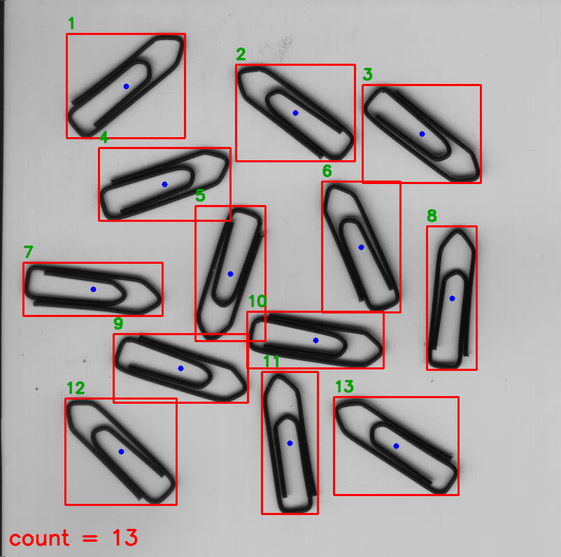

# 回形针自动计数 (Paperclip Counter)

基于 **C++ / OpenCV** 的回形针（曲别针）自动检测与计数，可直接在 **Visual Studio 2022** 里编译运行。



输入一张回形针散落在浅色桌面上的照片，程序自动框出每一个回形针并输出总数（本示例为 **13 个**）。

## 算法流程

```
读图 → 灰度 → 高斯模糊 → Otsu 反相阈值 → 形态学闭运算 → 连通域分析 → 面积/贴边过滤 → 计数 + 标注
```

| 步骤 | 作用 |
|---|---|
| 灰度 + 高斯模糊 (5×5) | 去掉传感器噪点，避免阈值后出现碎点 |
| Otsu 反相阈值 | 背景亮、回形针暗，用 `THRESH_BINARY_INV + THRESH_OTSU` 由直方图自动定阈值，不需要手调 |
| 闭运算 (椭圆核 5×5，2 次) | 钢丝上常有反光/细丝造成的小缺口，闭运算把它们重新连起来，防止一个回形针被拆成多段 |
| 连通域分析 (`connectedComponentsWithStats`) | 一个回形针的钢丝是一条连续曲线，天然就是一个连通域，统计连通域个数即为个数 |
| 过滤 | 丢弃面积 < 300 的噪点，以及贴着图像边缘的连通域（镜头暗角、边框线） |

代码在 `src/main.cpp`，全流程约 100 行，参数集中在 `Params` 结构体里。

## 环境要求

- Windows 10/11
- Visual Studio 2022（勾选「使用 C++ 的桌面开发」）
- CMake ≥ 3.16（VS2022 自带，或 `winget install Kitware.CMake`）
- OpenCV 4.x 的 **Windows 预编译包**（自带 MSVC 库，不需要自己编译）

## 一、准备 OpenCV

下载官方预编译包（约 100 MB），解压到任意目录，例如 `D:\Tools\opencv`：

```
https://github.com/opencv/opencv/releases/download/4.10.0/opencv-4.10.0-windows.exe
```

解压后目录结构应为：

```
D:\Tools\opencv\
├─ build\
│  ├─ include\            <- 头文件
│  └─ x64\vc16\lib\       <- 库文件 (opencv_world4100.lib)
└─ sources\
```

把 OpenCV 的 `build` 目录加到环境变量（用户变量即可）：

```
OpenCV_DIR = D:\Tools\opencv\build
```

## 二、编译运行

### 方式 A：命令行 / CMake（推荐）

```bat
cd paperclip-counter
cmake -S . -B build -G "Visual Studio 17 2022" -A x64 -DOpenCV_DIR="D:/Tools/opencv/build"
cmake --build build --config Release

:: 运行时需要能找到 DLL，二选一把 opencv_world4100.dll 复制到 exe 旁边
set PATH=D:\Tools\opencv\build\x64\vc16\bin;%PATH%
build\Release\paperclip_counter.exe images\paperclips.png results\annotated.png
```

也可以用 `CMakePresets.json`：

```bat
cmake --preset vs2022
cmake --build --preset release
```

### 方式 B：直接用 VS2022 打开

1. VS 菜单「文件 → 打开 → 文件夹」，选中本仓库根目录（VS 会自动识别 `CMakeLists.txt`）；
2. 等待 CMake 配置完成，首次可能需要在「项目 → CMake 设置」里指定 `OpenCV_DIR`；
3. 选择 `paperclip_counter.exe` 作为启动项，Ctrl+F5 运行。

### 方式 C：手动建空项目（不用 CMake）

新建「控制台应用」，把 `src/main.cpp` 加进去，然后在「项目属性」里填：

| 配置项 | 值 |
|---|---|
| C/C++ → 常规 → 附加包含目录 | `D:\Tools\opencv\build\include` |
| 链接器 → 常规 → 附加库目录 | `D:\Tools\opencv\build\x64\vc16\lib` |
| 链接器 → 输入 → 附加依赖项 | `opencv_world4120.lib`（文件名跟版本号走，4.10 就是 `opencv_world4100.lib`；Debug 配置用带 `d` 后缀的那个） |
| 平台 | 必须选 **x64**（预编译包没有 Win32 库） |

再把 `D:\Tools\opencv\build\x64\vc16\bin` 加进系统 `PATH`，或者在调试属性里设置「环境」。

## 三、运行

```bat
:: 默认图片
paperclip_counter.exe

:: 指定输入 / 输出
paperclip_counter.exe images\paperclips.png results\annotated.png

:: 附带输出二值掩膜，方便调参
paperclip_counter.exe images\paperclips.png results\annotated.png --debug
```

输出示例：

```
图片: images/paperclips.png  (802x796)
Otsu 阈值: 118
回形针数量: 13
结果图已保存: results/annotated.png
```

> 注意：程序内部用 `ifstream + imdecode` 读写图片，**中文路径也能正常工作**
> （`cv::imread` 在 Windows 上不支持中文路径，这是常见的坑）。

## 四、调参提示

参数都在 `src/main.cpp` 的 `Params` 里：

| 参数 | 默认 | 什么时候改 |
|---|---|---|
| `blurSize` | 5 | 噪点大就调大（7、9，必须奇数） |
| `closeSize` / `closeIter` | 5 / 2 | 一个回形针被数成 2 个 → 调大；相邻回形针粘连成一个 → 调小 |
| `minArea` | 300 | 图里有小碎屑被算进去 → 调大 |

换背景、换光照时通常只需要重跑，因为 Otsu 阈值是自适应的。

## 五、局限与可改进方向

- **回形针互相重叠**时两个钢丝连成一个连通域，会被数成 1 个。可加距离变换 + 分水岭拆分。
- **浅色/白色回形针**在浅色背景上对比度不足，Otsu 会失效，需要改用边缘检测或自适应阈值。
- 贴边的回形针会被当作边框过滤掉，属于当前策略的取舍。
- 只做计数，不做姿态估计；如需区分方向，可在每个连通域上做 `minAreaRect` 求长轴角度。

## 目录结构

```
paperclip-counter/
├─ CMakeLists.txt
├─ CMakePresets.json
├─ src/main.cpp            # 全部算法逻辑
├─ images/paperclips.png   # 测试图
├─ results/annotated.png   # 运行结果（已提交，方便预览）
└─ README.md
```

## License

MIT
